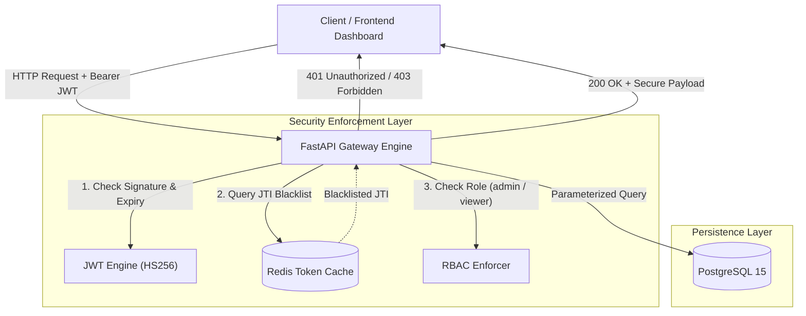
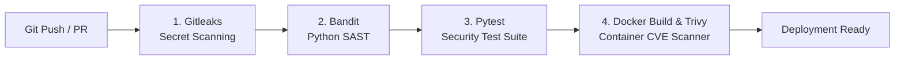

# Zero-Trust API Gateway & DevSecOps Pipeline

A modular FastAPI microservice engineered with Zero-Trust architecture principles. Every incoming request is strictly authenticated, authorized via Role-Based Access Control (RBAC), and verified against a real-time Redis token revocation blocklist before reaching downstream resources.

---

## System Architecture



---

## Automated DevSecOps CI Pipeline

Every push and pull request to the `main` branch is validated through an automated 4-stage security gate in GitHub Actions before artifact creation:



### CI Security Controls Explained

1. **Secret Scanning (Gitleaks):** Scans the entire commit history to block committed credentials, private keys, or API tokens.
2. **SAST (Bandit):** Static analysis against the Python AST to identify insecure imports, weak cryptographic primitives, or SQL injection vectors.
3. **Automated Security Tests (Pytest):** Tests role escalation attempts, token tampering, and revoked session rejection.
4. **Container & Dependency CVE Auditing (Trivy):** Scans the multi-stage Docker image and application libraries for High and Critical CVEs.

---

## Core Security Features

- **Stateful JWT Revocation:** Standard JWTs cannot be revoked without rotating the signing secret. This architecture injects unique `jti` claims and persists blacklisted tokens into Redis with a TTL matching token expiration time upon `/logout`.
- **RBAC Segmentation:** Complete decoupling of authentication and authorization. Critical administrative routes require explicit role verification.
- **Container Hardening:** Multi-stage Docker build separating dependencies from runtime. Runs as an unprivileged user (`appuser`) to restrict host-level impact upon container escape attempts.
- **SQLi Prevention:** Parameterized queries via `psycopg2` preventing injection attacks.

---

## Quick Start

### 1. Prerequisites & Environment Setup
```bash
cp .env.example .env
```

### 2. Run with Docker Compose
```bash
docker compose up --build -d
```

### 3. Verify Endpoints
- **Security Control Panel:** `http://localhost:8000/`
- **Swagger Documentation:** `http://localhost:8000/docs`
- **Health Check:** `http://localhost:8000/health`
